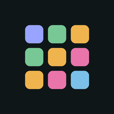
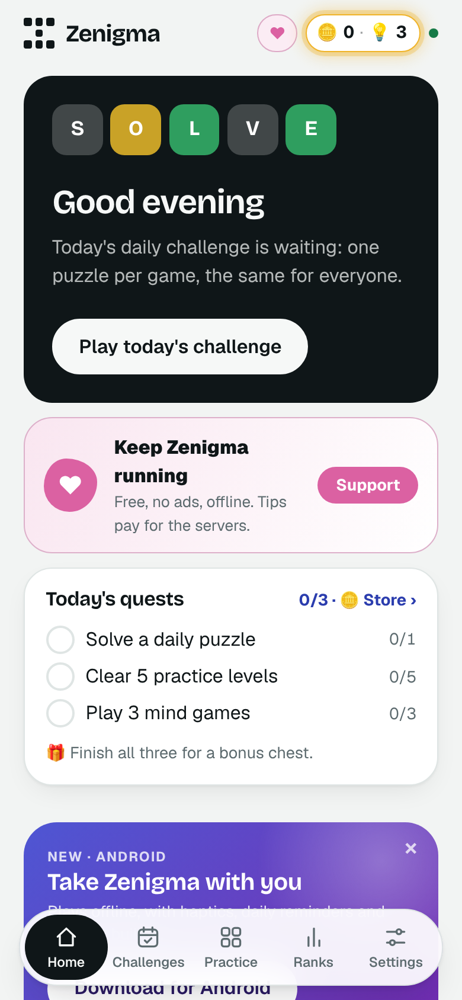
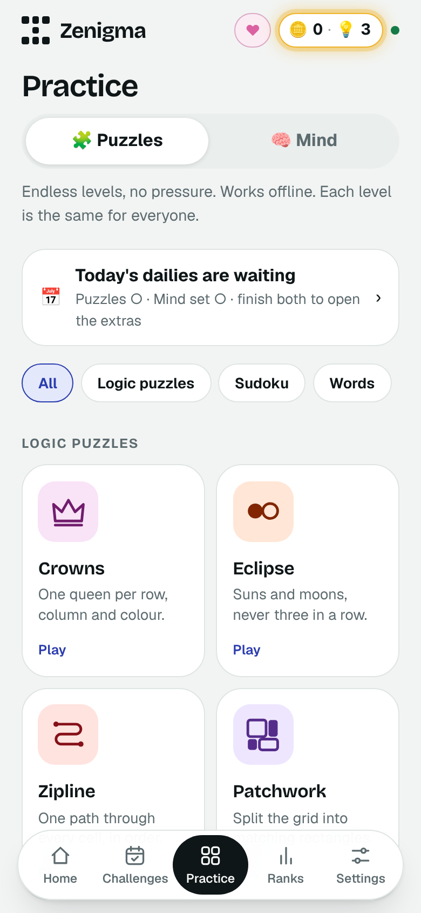
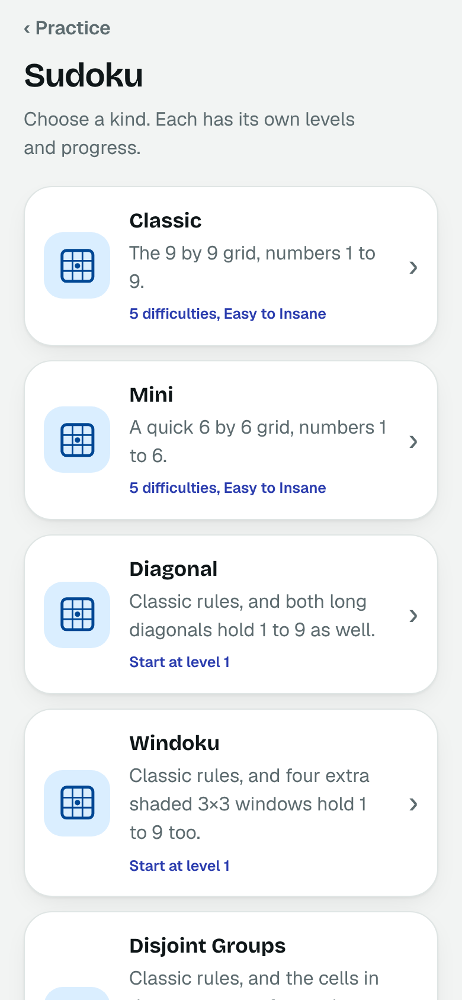
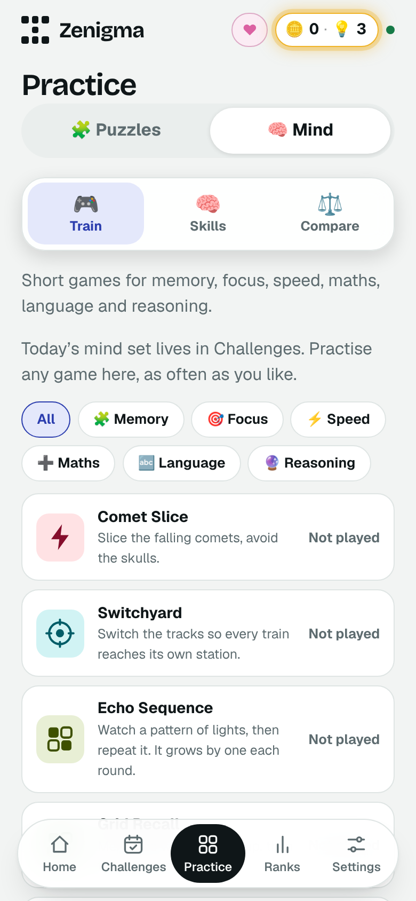
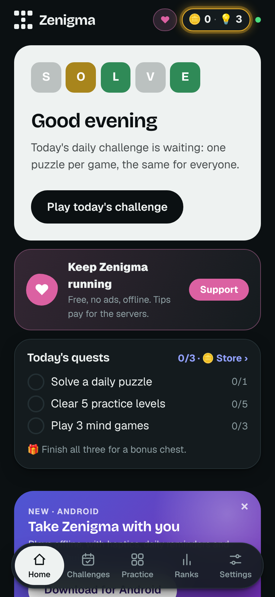
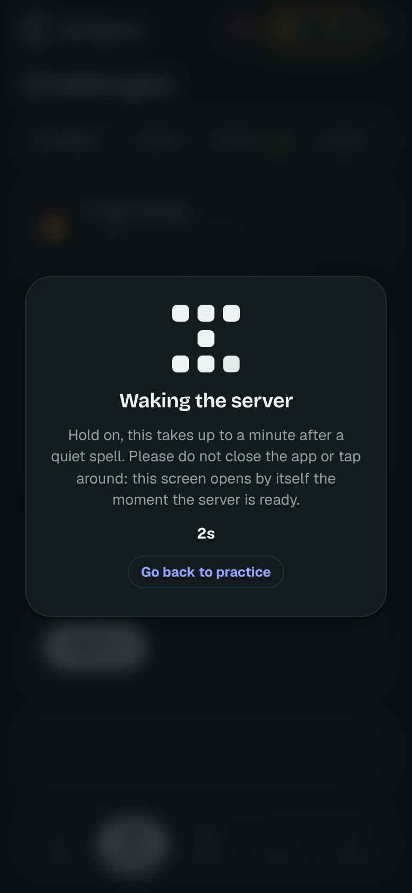
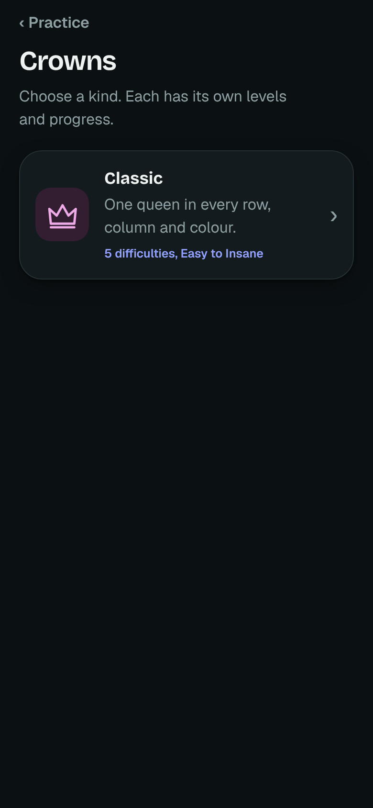
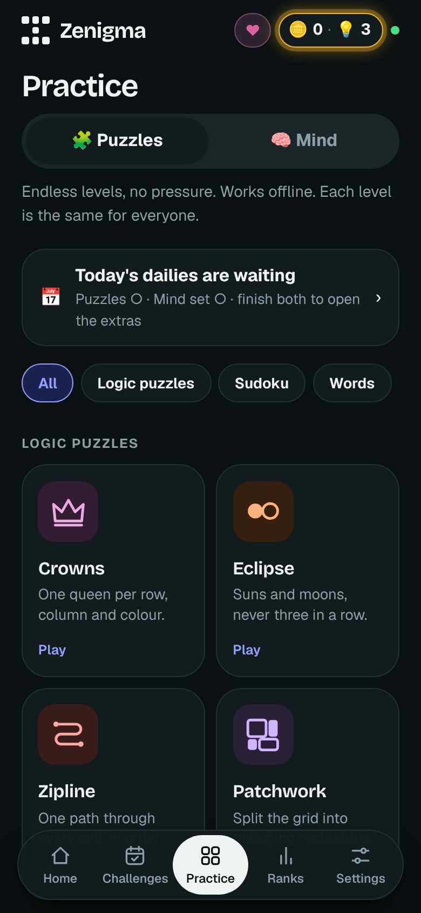
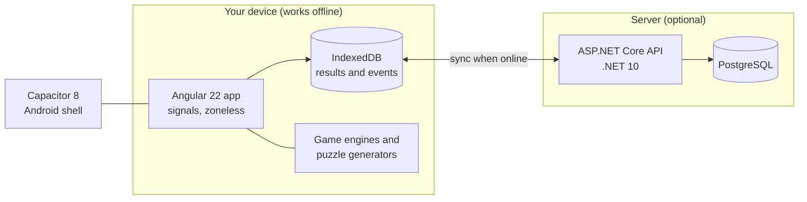

<div align="center">



# Zenigma

**Daily puzzles and brain games that work anywhere, even offline.**

Crowns · Eclipse · Sudoku · Zipline · Patchwork · Word Guess · 25 mind games · streaks · leaderboards

[](https://github.com/SMARTSKA97/Zenigma/actions/workflows/ci.yml)
[](https://github.com/SMARTSKA97/Zenigma/releases)
[](https://zenigma.ska97homelab.uk)


[](LICENSE)

[**Play now**](https://zenigma.ska97homelab.uk) · [**Download for Android**](https://github.com/SMARTSKA97/Zenigma/releases) · [**iPhone and iPad**](#iphone-and-ipad) · [Roadmap](docs/IDEAS.md)

</div>

<table>
  <tr>
    <td></td>
    <td></td>
    <td></td>
    <td></td>
  </tr>
  <tr>
    <td></td>
    <td></td>
    <td></td>
    <td></td>
  </tr>
</table>

## Why Zenigma

- **Plays offline, always.** Every puzzle ships with the app or is generated on the device. The server only adds the daily
  boards, leaderboards and sync, and it is never needed to play.
- **A new daily set, the same for everyone.** One puzzle per game each (India) day, a daily mind set of six games, and extra
  word dailies. Finish them all to keep your streak.
- **Endless levels and practice.** Easy to Insane, with a level map, hints that teach (“Show me” plays the next step) and a
  coach that explains the mistake.
- **Mind training.** 25 short games across memory, attention, speed, maths, language and logic, with a skills dashboard
  and an optional, private comparison with other players.
- **Fair and light.** No ads, no tracking, nothing locked behind a payment. Tips only help pay the server.

## Games

| | |
|---|---|
| **Logic** | Crowns, Eclipse, Zipline, Patchwork |
| **Sudoku** | Classic, mini and special rules, Easy to Insane |
| **Words** | Word Guess, Pindown, Chain Link, Word Climb, Wend |
| **Mind** | Comet Slice, Switchyard, Echo Sequence, Grid Recall, Number Recall, Pair Match, Colour Clash, Odd One Out, Quick Sums and more |
| **Around the games** | Daily streak with a shareable card, weekly and monthly challenges that earn hints, badges, circles and leaderboards |

## Get the app

### Android

Download the latest `.apk` from the [Releases page](https://github.com/SMARTSKA97/Zenigma/releases) and open it. The app
checks for new versions itself and installs them with one tap.

### iPhone and iPad

There is no App Store app: Zenigma is an installable web app that looks and feels like one.

1. Open [zenigma.ska97homelab.uk](https://zenigma.ska97homelab.uk) in **Safari**.
2. Tap **Share**, then **Add to Home Screen**, then **Add**.
3. Open Zenigma from your Home Screen. It runs full screen and works offline.

Updates arrive by themselves; tap **Reload** when “Update ready” appears. The app has a picture guide under
**Settings → Install**. Sign in to bring back your results: the installed app keeps its storage apart from Safari.

### Web

Play in any modern browser at [zenigma.ska97homelab.uk](https://zenigma.ska97homelab.uk), and use your browser’s
**Install** button to add it to your desktop or phone.

## How it works



- **Offline-first.** Results are events in an on-device log. They sync to the server when a connection exists, are applied
  once, and come back to any device you sign in on.
- **One codebase.** The same Angular app is the website, the installable web app and the Android app (Capacitor).
- **Shared engines.** The TypeScript and C# game engines are checked against the same test vectors in `tests/vectors`.
- **Gentle on the server.** The app never wakes the server just by opening; boards, the daily and sign-in do.

## Repository

| Path | What |
|---|---|
| `apps/web` | Angular 22 app (also the Android UI) and the Capacitor Android project |
| `apps/api` | .NET 10 API: auth, sync, leaderboards, server clock |
| `db/migrations` | Flyway SQL migrations (the only way the schema changes) |
| `tools/generators` | Puzzle and level generators |
| `tests/vectors` | Shared test vectors for the TypeScript and C# game engines |
| `mobile/release-notes` | One `<version>.md` per Android release |
| `docs` | [Deployment](docs/DEPLOYMENT.md), [operations](docs/OPERATIONS.md), [scaling](docs/SCALING.md), [security](docs/SECURITY.md), [roadmap](docs/IDEAS.md) |

## Develop

Secrets live in a git-ignored `.env` file, never in source. Start from the template:

```bash
cp .env.example .env        # fill in the blanks; generate values with: openssl rand -base64 48
docker compose up -d db                 # local Postgres (uses POSTGRES_* from .env)
docker compose run --rm migrate         # apply db/migrations with Flyway

# API (http://localhost:5080): reads .env automatically in development
cd apps/api/Zenigma.Api && dotnet run --urls http://localhost:5080

# Web (http://localhost:4200)
cd apps/web && npm ci && npx ng serve
```

The API’s `ConnectionStrings__Default` password must match `POSTGRES_PASSWORD`. In production the same names are set as
environment variables and GitHub secrets; see [docs/DEPLOYMENT.md](docs/DEPLOYMENT.md).

**Tests:** `dotnet test apps/api/Zenigma.slnx` (set `ZENIGMA_TEST_DB` in `.env` to run the database tests) and
`cd apps/web && npx ng test`. CI runs both, the puzzle generators, an Android debug build and a dependency audit on every push.

## Support

Zenigma is free and has no ads. The server, database, domain and email service are paid for by one person; a tip of any
size keeps the daily puzzles and leaderboards online. It unlocks nothing. You can tip from **Settings → Contributors**
(UPI, GitHub Sponsors and more).

## Contributing

Bug reports and ideas are welcome: open an issue. For code, branch from `main`, keep the tests green, and see
[SECURITY.md](SECURITY.md) to report a vulnerability privately.

## License

[MIT](LICENSE) © 2026 Subhrajit Karmakar
